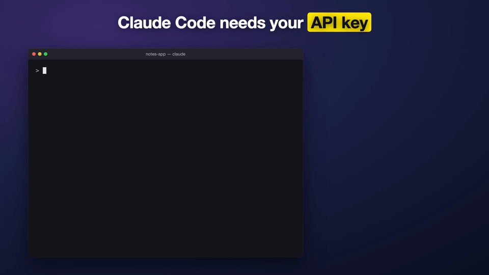

# claude-textedit-secrets

Stop pasting API keys into Claude Code's chat.

When Claude Code needs a key, it opens the right file (`.env`, config, …) in TextEdit with
`YOUR_KEY=` already filled in. You paste, save, and close the window. Claude notices the window
closed, checks the value is set, and keeps going. **The key never enters the conversation.**



## Install (macOS)

```bash
curl -fsSL https://raw.githubusercontent.com/jzhou1402/claude-textedit-secrets/main/install.sh | bash
```

This adds two files:

- `~/.claude/rules/secrets-open-in-textedit.md`: a global rule telling Claude to use the script instead of asking you to paste keys.
- `~/.claude/bin/wait-secret-file.sh`: adds the `VAR=` placeholder, opens TextEdit, waits for the window to close, then prints `DONE` or `EMPTY`. It never prints the value.

Start a new Claude Code session afterwards so it picks up the rule.

## Notes

- macOS only. The first run may ask to let your terminal control TextEdit; allow it, since that's how the script tells whether the window is closed.
- Existing file contents are left alone. The placeholder is added only if the variable is missing.
